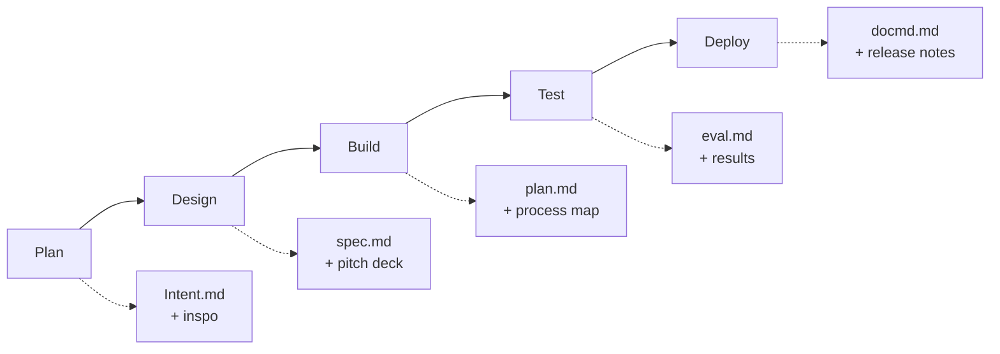

# QSDLC

**Quintessence Software Development Lifecycle** is a skill library that gives AI models and subagents a structured, repeatable path through software work: **Plan, Design, Build, Test, Deploy.** Each stage produces one durable markdown document and one HTML artifact, so the reasoning behind a piece of work stays inspectable after the chat is gone.

QSDLC v2 runs in two modes over the same documents:

- **Interactive lifecycle.** A person drives one feature through the five stages and confirms each stage before the next starts.
- **Continuous Software Factory.** Scheduled or queued runs triage a ticket into a track, work in an isolated worktree, pass through check-gates instead of confirmations, and end at a draft PR or a mailbox entry. Nothing auto-merges. See [[Continuous Factory]].

## The five stages

| Stage | Document | Artifact | Skill |
|---|---|---|---|
| [[1 - Plan]] | `Intent.md` | inspiration | [[qsdlc-interview]] |
| [[2 - Design]] | `spec.md` | design pitch deck | [[qsdlc-design]] (+ [[qsdlc-feature-research]]) |
| [[3 - Build]] | `plan.md` | implementation process map | [[qsdlc-build]] (+ [[qsdlc-review]], developer skills) |
| [[4 - Test]] | `eval.md` | performance results | [[qsdlc-qa]] (+ [[qsdlc-verify]]) |
| [[5 - Deploy]] | `docmd.md` | release notes | [[qsdlc-pr]] |

All five live together per feature at `.qsdlc/<feature-slug>/` inside the project the skills run against. See [[Documents]] and [[Artifacts]] for the exact contract.

## Five tracks

[[qsdlc-triage]] sizes each piece of work and records the track in `state.md`. Stages a track does not need are listed under `Skipped`, never implied by a missing file.

| Track | For | Stages |
|---|---|---|
| `quick` | clear intent, about one session, no protected paths | Build, Test, Deploy |
| `bugfix` | broken behavior with a repro | Assess, Fix, Test (red then green), Deploy |
| `delta` | a change to an established system | short Plan, Design as ADDED/MODIFIED/REMOVED, Build, Test, Deploy |
| `full` | novel capability, unclear intent, large scope | all five |
| `discovery` | the output is knowledge or a decision | Plan, Research, Decide |

Risk can only raise a track. Work that touches a protected path always ends in a human-reviewed PR.

## The factory

- **Autonomous runs** follow [[qsdlc-factory]]: preflight, an isolated worktree, the track's stages as check-gates, then a terminal status (`done`, `needs-review`, `blocked`, `declined`, `failed`, `partial`).
- **Scheduled loops** are rituals plus an external scheduler: ticket funnel, queue drain, regression and UX sweeps, canary, scout, debt sweep, correction pass, and a weekly audit that closes one finding. See [[qsdlc-sweep]], [[qsdlc-ritual]], and [[Setting up Scheduled Rituals]].
- **Deterministic enforcement.** Anything a script can check, a script checks: `qsdlc-lint` (V1 to V12), the `qsdlc-log` logger, and the [[qsdlc-guard]] hook that blocks destructive commands and protects `policy.md` paths. [[qsdlc-correct]] turns a repeated mistake into a check.
- **Brand-bound presentations.** [[qsdlc-present]] builds every artifact as one self-contained HTML file bound to the target product's own design tokens, with [[html-motion]] engines when motion earns its place, and [[qsdlc-archify]] when a stage needs deep interactive diagrams (`sequence`, `erd`, `architecture`, `timeline`).
- **Knowledge graph & Herdr orchestration.** [[qsdlc-graphify]] connects local deterministic AST knowledge graphs for fast impact, path, and drift checks, while [[qsdlc-herdr]] runs Trevor's nine Agent Relay Patterns as Herdr panes with GREAT briefs and a verified PASS gate.

## Skill map

| Group | Skills |
|---|---|
| Entry and sizing | [[qsdlc]], [[qsdlc-triage]] |
| Stage skills | [[qsdlc-interview]], [[qsdlc-design]], [[qsdlc-feature-research]], [[qsdlc-build]], [[qsdlc-qa]], [[qsdlc-pr]] |
| Build and test support | [[qsdlc-review]], [[qsdlc-verify]], [[qsdlc-herdr]], [[Developer Skills]] (`qsdlc-dev-web`, `qsdlc-dev-api`, `qsdlc-dev-cli`) |
| Factory | [[qsdlc-factory]], [[qsdlc-sweep]], [[qsdlc-ritual]], [[qsdlc-audit]], [[qsdlc-correct]], [[qsdlc-guard]] |
| Presentation & tools | [[qsdlc-present]], [[html-motion]], [[qsdlc-archify]], [[qsdlc-graphify]] |

## Getting started

Run the kickoff skill, `qsdlc`, in a project. It finds whether a feature is in progress, triages a new one into a track, and either walks the stages with your confirmation at every boundary or hands an eligible ticket to the factory. See [[Why QSDLC]] for why those boundaries exist in interactive mode and what replaces them in autonomous mode.

Not installed yet? See [[Install as a Plugin]] or [[Install Individual Skills]]. Want scheduled loops? See [[Setting up Scheduled Rituals]].

## Map of this vault

- [[Why QSDLC]]: the case for a structured lifecycle over ad-hoc prompting
- **01 Stages**: one note per stage ([[1 - Plan]] through [[5 - Deploy]])
- **02 Skills**: one note per skill
- **03 Reference**: [[Documents]], [[Artifacts]], [[Continuous Factory]], [[Glossary]]
- **04 Installation**: [[Install as a Plugin]], [[Install Individual Skills]], [[Adding a Developer Skill]], [[Setting up Scheduled Rituals]]
- **05 Research**: [[Poteto - All Code Is Slop and pstack]] and [[Alternatives to pstack]], the notes behind the v2 design

The skill implementations live under `/skills/` at the repo root. These vault notes document them; they are not the skills themselves.
