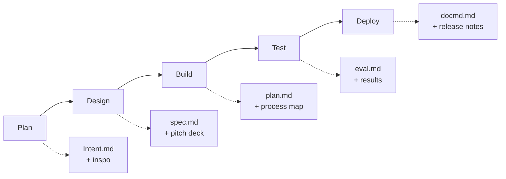

# QSDLC

**Quintessence Software Development Lifecycle** — a skill library that gives AI models and subagents a structured, repeatable path through feature work: **Plan → Design → Build → Test → Deploy.**

Each stage produces one durable markdown document and one polished artifact, so the reasoning behind a piece of work is inspectable long after the work is done — not scattered across a chat transcript.

## The five stages

| Stage | Document | Artifact | Skill |
|---|---|---|---|
| [[1 - Plan]] | `Intent.md` | inspiration | `qsdlc-interview` |
| [[2 - Design]] | `spec.md` | design pitch deck | `qsdlc-design` (+ `qsdlc-feature-research`) |
| [[3 - Build]] | `plan.md` | implementation process map | `qsdlc-build` (+ developer skills) |
| [[4 - Test]] | `eval.md` | performance results | `qsdlc-qa` |
| [[5 - Deploy]] | `docmd.md` | release notes | `qsdlc-pr` |

All five live together per feature at `.qsdlc/<feature-slug>/` inside whatever project the skills run against — see [[Documents]] and [[Artifacts]] for the exact contract.

## Getting started

Run the kickoff skill — `qsdlc` — in a project. It figures out whether you're starting a new feature or resuming one, then walks the stages, invoking each stage skill in turn and pausing for your confirmation at every boundary (see [[Why QSDLC]] for why those pauses matter).

Not installed yet? See [[Install as a Plugin]] or [[Install Individual Skills]].

## Map of this vault

- [[Why QSDLC]] — the case for a structured lifecycle over ad-hoc prompting
- **01 Stages** — one note per stage: purpose, inputs, outputs
- **02 Skills** — one note per skill: what it does, when it triggers, what it produces
- **03 Reference** — [[Documents]], [[Artifacts]], [[Glossary]]
- **04 Installation** — [[Install as a Plugin]], [[Install Individual Skills]], [[Adding a Developer Skill]]

The actual skill implementations live outside the vault notes, under `/skills/` at the repo root — these vault notes document them, they aren't the skills themselves.
