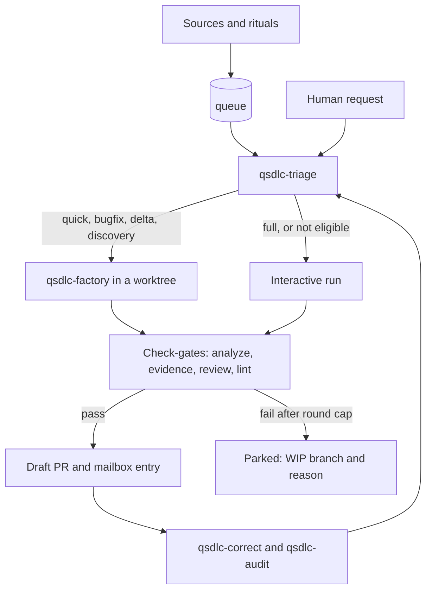

# Continuous Factory

QSDLC runs in two modes over the same five documents. **Interactive** is the original lifecycle: a person confirms each stage. **Autonomous** is the Continuous Factory: scheduled or queued runs that move through the stages on checks instead of confirmations, work in an isolated worktree, and end at a draft PR or a mailbox entry. Both write the same `.qsdlc/` files (see [[Documents]]).

This note is the reference for the factory side. The reasoning is in [[Why QSDLC]]; the setup steps are in [[Setting up Scheduled Rituals]].

## Autonomy tiers

| Tier | Who gates | What may leave the machine |
|---|---|---|
| Interactive | A person confirms every stage in that turn | `qsdlc-pr` asks for a separate go-ahead before staging, committing, pushing, or opening a PR |
| Autonomous with a standing grant | Check-gates: spec analyze, eval evidence, two-stage review, `qsdlc-lint --strict`. No human wait mid-run | The run branch `qsdlc/auto/<name>-<date>` and a **draft** PR, only if `policy.md` `autonomous.grants` has `push_branch` and `open_draft_pr` |
| Autonomous without a grant | Same check-gates | Nothing. The run declines, logs, writes a mailbox entry, and leaves a local branch |
| Autonomous on protected paths | Same check-gates, plus a human reviews the PR | A draft PR labeled `needs-human-review`; the run can only end `needs-review`, never `done` |

Never, in any autonomous tier: auto-merge, push to the default or any shared branch, force-push, publish, or deploy. Readiness is a human decision.

This is Trevor's Autonomy and Escalation Policy applied to software work: **act, log, and tell; do not pause to ask.** The only things that reach a person are a one-time authentication and a missing install, both at setup time. Telling is not asking: the mailbox is a notification, nothing waits on a reply.

- **Missing input** ends the run `declined: insufficient-intent` with a mailbox entry. **Ambiguity** gets a recorded Ruling (what, why, cost if wrong) in `Intent.md` or `ledger.md`.
- **Limits decline and log.** Raising a limit is a human edit to `policy.md`, never a live approval prompt.
- **Deletes are soft.** [[qsdlc-guard]] rewrites a delete into a move under `.qsdlc/archive/<run-id>/`; regenerable material (`node_modules`, `dist`, caches) is deleted outright. Every action is logged with how to reverse it.
- **Isolation.** Every run gets its own worktree and branch, off a recorded base SHA, and never works on the default branch.

### Terminal status

Every autonomous run ends with exactly one of `done`, `needs-review`, `blocked`, `declined`, `failed`, or `partial`, written to `run.json` and to `Terminal status` in `state.md`. Exit code `0` for `done` and `needs-review`, `1` otherwise. `run.json` keys: `run_id, loop, ticket, track, mode, status, base_sha, head_sha, branch, pr_url, budgets_used, assumptions[], rulings[], parked[], unverified[], failed_or_skipped[], also_changed[]`.

## Tracks

[[qsdlc-triage]] picks the track; `Skipped` in `state.md` records the stages left out. A run that outgrows its track is re-triaged upward and keeps its documents. Risk can only raise a track: protected paths force `bugfix` or `delta` at minimum.

| Track | Use when | Stages that run | Autonomous? |
|---|---|---|---|
| `quick` | intent clear, about one session, no protected paths | Build (one phase), Test, Deploy | yes |
| `bugfix` | existing behavior is broken, a repro exists or can be made | Assess (read-only root cause), Fix, Test (red then green), Deploy | yes |
| `delta` | behavior change in an established system | Plan (short), Design (ADDED/MODIFIED/REMOVED), Build, Test, Deploy | yes |
| `full` | novel capability, unclear intent, large scope | all five | no; may only draft `Intent.md` and `spec.md` into a PR |
| `discovery` | the output is knowledge or a decision | Plan (question), Research, Decide | yes (read-only) |

`discovery` ends in a verdict: `go`, `needs-clarification`, or `kill`.

## policy.md

`.qsdlc/factory/policy.md` is human-owned. A run never edits it, and the guard denies the edit. It holds the project's own rules; product-specific knowledge belongs here, not in the skills. Template: `/skills/_shared/templates/policy.template.md`.

| Key | Default in the template | Effect |
|---|---|---|
| `constitution` | three starter rules | Non-negotiable. Analyze treats a conflict as CRITICAL |
| `protected_paths` | globs for billing, payroll, tax, exports, auth, migrations | Edits allowed only on the `needs-review` outcome |
| `md_allowlist` | `docs/**`, `README.md`, `CHANGELOG.md` | V9 allows new markdown only here |
| `max_comment_ratio` | 0.25 | V11 warns above it |
| `autonomous.grants` | `commit_branch`, `push_branch`, `open_draft_pr` | Never grantable: merge, default-branch push, force-push, publish, deploy |
| `autonomous.max_files` | 12 | Over the limit: decline and log |
| `autonomous.max_changed_loc` | 500 | same |
| `autonomous.max_fix_rounds` | 2 | Round cap in [[qsdlc-review]] |
| `autonomous.max_open_auto_prs` | 3 | [[qsdlc-factory]] and queue-drain refuse at the cap |
| `autonomous.max_runtime_minutes` | 90 | same |
| `autonomous.max_tokens_per_run` | 1500000 | same |
| `autonomous.protected_path_outcome` | `needs-review` | |
| `autonomous.delete` | `soft`, `archive_retention_days: 30` | Deletes go to `.qsdlc/archive/` |
| `autonomous.mutation_targets` | `localhost`, `*.test`, `staging` | Where verification may act; elsewhere it only looks |

The numbers are placeholders. Calibrate them from the first 20 runs recorded in `runs/<run-id>/run.json`.

## Scheduled loops

A loop is a ritual definition in `.qsdlc/rituals/<name>.md` plus an external scheduler entry (Windows Task Scheduler, cron, or `/schedule`) that runs `claude -p`. See [[qsdlc-ritual]] and [[Setting up Scheduled Rituals]]. Rituals ship `enabled: false`.

| Loop | Runs | What it does |
|---|---|---|
| `ticket-funnel` | `qsdlc-sweep ticket-funnel` | Reads approved sources, writes `proposed` tickets to `queue/` |
| `queue-drain` | `qsdlc-sweep queue-drain` | Takes one eligible ticket, triages it, runs [[qsdlc-factory]] |
| `regression-sweep` | `qsdlc-sweep regression-sweep` | Drives the feature map on localhost or staging, alerts on change from baseline |
| `ux-perf-sweep` | `qsdlc-sweep ux-perf-sweep` | Same, for UX and performance checks |
| `canary` | `qsdlc-sweep canary` | Post-deploy monitoring; recommends a rollback, never performs one |
| `scout` | `qsdlc-sweep scout` | Competitive and product feature scouting; candidates stay `proposed` |
| `debt-sweep` | `qsdlc-sweep debt-sweep` | Shortcut markers with no upgrade trigger, stale living specs |
| `compound` | [[qsdlc-correct]] | Moves repeated corrections up the enforcement ladder |
| `weekly-level-up` | [[qsdlc-audit]], then one fix | Closes the single highest-priority audit finding; a clean audit forces no fix |

Loops wake quietly: with nothing to decide, a run ends without messaging anyone. State for sweeps goes through `sweep-state.mjs`, the only writer of cursor, lease, and seen set. A ritual with no scheduler entry and no run evidence is audited as "manual claim, no evidence".

## The correction ratchet

Every correction a person gives an agent is logged; a class counts at its **second occurrence**, and then [[qsdlc-correct]] fixes it at the highest level that works, instead of adding another line to a prompt.

1. `qsdlc-log.mjs correction` appends a row to the append-only `.qsdlc/factory/corrections.tsv`.
2. The enforcement ladder, highest first: architecture, types, a lint or CI check, tests, docs or agent rules last.
3. An enforcer is only `enforced` with a **proof commit**: the check run against the original mistake, shown failing. V7 verifies the enforcer exists and the proof SHA is an ancestor of `HEAD`.
4. `rules.md` is generated from `corrections.tsv` and never hand-edited.
5. Metrics from `qsdlc-log.mjs metrics`: `doc_level_share` (how much is still held only in prose), `repeat_rate` (an enforced class that recurred), and `uncovered_classes`.

The developer skills list what enforces each convention and flag prose-only rows `promote-to-check`; see [[Developer Skills]].

## Deterministic enforcement

Prose is the weakest layer, so anything a script can check, a script checks. `<SKILLS>` is the skills directory, the parent of `_shared/`. All scripts need Node 20 or newer.

- `node <SKILLS>/_shared/scripts/qsdlc-lint.mjs --root <project> [--slug s] [--fix-rules] [--json] [--strict]`: runs V1 to V12. Errors exit 1; warnings (V10, some V11) exit 1 only with `--strict`, which autonomous runs use. Run it before every stage confirmation and every draft PR.
- `node <SKILLS>/_shared/scripts/qsdlc-log.mjs <start|row|end|correction|rules|metrics|mailbox|sanitize>`: appends to run logs, corrections, and the mailbox; regenerates `rules.md`; prints metrics.
- `node <SKILLS>/qsdlc-guard/scripts/guard-check.mjs`: the PreToolUse hook (see [[qsdlc-guard]]).
- `node <SKILLS>/_shared/test/run_tests.mjs`: the test suite for the scripts, the guard, and the sweep-state writer.

| Code | Checks |
|---|---|
| V1 | Layout: only contract files and folders, kebab-case slug, `state.md` present, each stage document present unless its stage is in `Skipped` |
| V2 | `state.md` fields in their enums, protected risk never `done`, log lines dated and append-only against `git show HEAD:` |
| V3 | `eval.md` table shape, unique ids, no `pass` without an Evidence pointer that resolves, summary totals equal the table |
| V4 | Feature map shape under `factory/verify/`: the four H2s, `Preconditions:` line, exact commands, unique kebab ids, index links |
| V5 | Evidence `manifest.json` keys, `pii_scrubbed: true`, a doctor check before a pass, personal-data patterns in evidence |
| V6 | Run log TSV header and cell counts |
| V7 | `corrections.tsv` shape, enforced rows have an existing enforcer and an ancestor proof SHA, expired exceptions, `rules.md` in sync |
| V8 | Autonomous features need `policy.md` and a base SHA; a diff touching protected paths requires `Risk: protected` and not `done` |
| V9 | No unsolicited markdown outside the QSDLC record and the `md_allowlist` |
| V10 | Prose: banned words and filler phrases in the documents (warning) |
| V11 | Comments: suppressions need a `qsdlc-exception(reason; expires; approver)` record, no "do not remove" markers, shortcut markers need an `upgrade:` trigger, comment ratio |
| V12 | Formal models under `verify/formal/`: `covers:` globs and a `sync_commit` that is an ancestor of `HEAD`, stale if covered code changed since |

## Relay patterns, GREAT, and Herdr

Trevor's nine Agent Relay Patterns are the sequencing vocabulary. Each `plan.md` phase carries a `Pattern:` tag next to its developer skill tag, chosen by asking whether the work is a branch, a loop, or a swarm.

| Pattern | Where it shows up in QSDLC |
|---|---|
| Multipart Phases | Phases or product areas that need separate treatment from the start; disjoint-ownership lanes |
| Dependency | The stage chain (Intent, spec, plan, eval, docmd); bugfix assess, then fix, then test |
| Comparative | Prototype forks in [[2 - Design]]; candidate lanes with a blind judge |
| Pagination | `queue-drain` and any same-shape list processed one item at a time |
| Audit | The two-stage review and fix loop in [[qsdlc-review]], with a round cap |
| Realignment | `weekly-level-up`, [[qsdlc-audit]], and replanning when a phase shows the plan was wrong |
| Scatter | Independent plan phases and sweep pages dispatched concurrently |
| Consensus / Polling | The reviewer persona roster reconciled into one verdict |
| Batch Testing | `eval.md` rows run in parallel across devices or arms |

**GREAT** (Grounding, Role, Execution, Analysis, Takeaway) is the shape of every subagent brief and return. The orchestrator reads only the Takeaway plus deterministic evidence, which also protects its context from long transcripts. Stage skills and loops end their replies in GREAT form.

**Herdr** runs the swarm and loop patterns as panes: one named agent per lane, file-backed briefs, `--wait` barriers, a `blocked` lane treated as a fault in autonomous mode, and lanes that never merge. See [[qsdlc-herdr]].

## See also

[[QSDLC]], [[Why QSDLC]], [[Documents]], [[Artifacts]], [[Glossary]], [[Alternatives to pstack]], [[Poteto - All Code Is Slop and pstack]]
